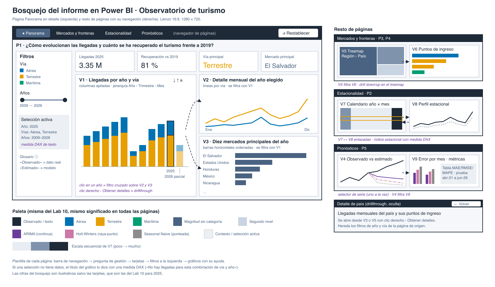

# 1. Contexto y público

Este informe es la segunda versión del cuadro de mando del observatorio de turismo sostenible que
construimos en el Laboratorio 10 con Plotly Dash. Ahora lo hacemos en Power BI Desktop, como un informe
`.pbix`, para comparar las dos herramientas con el mismo problema, los mismos datos y los mismos
resultados de modelos.

El público no cambia. Son directivos y tomadores de decisiones del sector turístico, por ejemplo de
INGUAT, cámaras de turismo u operadores, que no necesariamente conocen estadística. Por eso cada página
abre con la pregunta que responde, usa cifras redondeadas, separa lo observado de lo estimado y explica
los términos técnicos en lenguaje llano.

Versión del Laboratorio 10: <https://github.com/nicoCT04/Lab10-DataSicence>, commit `27d624b`.

# 2. Preguntas de gestión

Conservamos las cinco preguntas del Laboratorio 10 sin cambios, porque el enunciado pide que ambas
versiones respondan lo mismo para que la comparación sea válida.

| # | Pregunta de gestión | Decisión que apoya | Página |
|--|--|--|--|
| P1 | ¿Cómo evolucionan las llegadas y cuánto se ha recuperado el turismo frente a 2019? | Fijar metas anuales y medir la recuperación pospandemia | Panorama |
| P2 | ¿En qué meses se concentra la demanda, temporada alta y baja? | Planificar capacidad, personal y campañas para la temporada baja | Panorama, Estacionalidad |
| P3 | ¿Qué mercados de origen aportan más visitantes y cómo cambia su peso? | Priorizar la promoción y medir la dependencia de pocos mercados | Panorama, Mercados y fronteras |
| P4 | ¿Por qué vías y puntos fronterizos ingresan los visitantes? | Priorizar inversión en infraestructura y servicios de frontera | Panorama, Mercados y fronteras |
| P5 | ¿Qué tan confiables son las estimaciones de llegadas y qué modelo conviene como referencia? | Decidir cuánto confiar en un pronóstico al presupuestar | Pronósticos |

# 3. Alcance

El alcance es el mismo del Laboratorio 10.

Incluye las llegadas mensuales de turistas y excursionistas de enero de 2009 a junio de 2026, por año,
mes, vía, punto de ingreso, país, región y mercado de residencia, que es la definición estable de todo
el periodo usada desde el Laboratorio 1. Incluye también las predicciones y métricas de los tres modelos
del Laboratorio 10, ARIMA(1,1,1), Holt-Winters y Seasonal Naive, para las series Total, Aérea y
Terrestre, con el mismo conjunto de prueba, de abril de 2021 a junio de 2026, 63 meses que los modelos
no vieron. En Power BI no se entrena ni se recalcula ningún modelo. Las predicciones se importan de
`outputs/predictions.csv` y `outputs/metrics.csv` del Laboratorio 10 sin modificarlas.

Decisiones que el informe puede apoyar.

- Comparar el nivel de llegadas de un año con 2019 y con años anteriores.
- Identificar los meses de mayor y menor demanda para planificar personal, capacidad y campañas.
- Ver qué mercados pesan más y qué tan concentrada está la demanda en pocos países.
- Ver por qué puntos de ingreso entra cada mercado para priorizar servicios de frontera o conectividad
  aérea.
- Decidir cuánto confiar en un pronóstico sencillo y en qué meses tratarlo con más cautela.

Lo que queda fuera de su alcance.

- Gasto, ocupación hotelera, empleo o impacto ambiental, porque la base solo registra llegadas. La
  concentración estacional se usa como aproximación de la presión sobre los destinos, no como una medida
  de ella.
- Explicar por qué cambia la demanda. Los datos describen patrones, no causas.
- Pronósticos oficiales. Los tres modelos son sencillos, se entrenaron con datos que terminan en plena
  pandemia y subestiman la recuperación, así que se presentan como referencia para comparar modelos.
- La vía marítima por tipo de viajero desde 2017, que la base no separa. 2026 solo tiene enero a junio
  y se marca como año parcial.

# 4. Paleta de colores y fuentes

Conservamos la paleta del Laboratorio 10 con el mismo significado, porque un directivo que use las dos
versiones no debería volver a aprender qué quiere decir cada color. Está en
`powerbi/tema_observatorio.json` como tema de Power BI, y se aplica en Vista, Temas, Examinar temas.

| Rol | Color | Justificación |
|--|--|--|
| Observado y texto | `#1E2A38` | Azul casi negro, máximo contraste sin la dureza del negro puro. Toda cifra observada usa este tono. |
| Vía Aérea | `#0072B2` | Paleta Okabe-Ito, distinguible con daltonismo. Azul por el aire. |
| Vía Terrestre | `#E69F00` | Naranja tierra, complementario del azul, máxima separación entre las dos vías principales. |
| Vía Marítima | `#009E73` | Verde azulado por el mar, tercer color de Okabe-Ito. |
| Magnitud sin categoría | `#4A6382` | Azul gris neutro para rankings de mercados, no se confunde con ninguna vía. |
| Segundo nivel de jerarquía | `#C9D4E2` | El mismo neutro aclarado, para países dentro de su región. |
| Escala secuencial | `#E8EDF3` → `#7F93AD` → `#1E2A38` | Un solo tono de poco a mucho para el calendario, sin usar colores de vía ni de modelo. |
| Estimaciones | `#6A3D9A`, `#CC79A7`, `#8C8C8C` | Morado, rosa y gris, que nunca se usan para datos observados. Cada modelo tiene además su tipo de línea, continua, raya-punto y punteada, para no depender solo del color. |
| Contexto y selección activa | `#ECEFF3` | Franjas de periodos especiales, como la pandemia o la evaluación, y el recuadro de la selección activa. |
| Fondo de página y tarjetas | `#F5F7FA`, `#FFFFFF` | Fondo claro de baja saturación para que el color se reserve a los datos. |

Reglas que se mantienen. Un color significa lo mismo en todas las páginas. La selección se marca con el
resaltado nativo de Power BI, que atenúa lo no seleccionado, en lugar de agregar colores nuevos. Las
etiquetas Observado y Estimado separan hallazgos de estimaciones.

Power BI asigna los colores de `dataColors` según el orden en que aparecen las categorías, no por su
nombre. Para que Aérea, Terrestre y Marítima conserven su color en todos los gráficos, la columna `Vía`
se ordena por `OrdenVía`, y si algún gráfico los cambia se fijan a mano en el panel de formato.

Fuentes. En el Laboratorio 10 usamos Source Sans 3 de Google Fonts. Power BI Desktop solo ofrece las
fuentes instaladas en Windows y no las incrusta en el `.pbix`, así que si usáramos una fuente externa el
informe se vería distinto en otra computadora. Por eso la cambiamos por Segoe UI, sans serif de la
familia del sistema con legibilidad parecida. La jerarquía es la misma, título del gráfico 13 pt,
cuerpo 11 pt y ejes 10 pt, y las cifras grandes usan unidades abreviadas, como 1.2 M o 250 mil.

# 5. Bosquejo de la interfaz y navegación

{width=100%}

El Laboratorio 10 se organizaba en cuatro pestañas. En Power BI cada pestaña se vuelve una página con
la misma plantilla, barra de navegación, pregunta de gestión, tarjetas, filtros a la izquierda y
gráficos con su ayuda. El orden sigue el de las preguntas, de lo general a lo particular y de lo
observado a lo estimado.

1. Panorama, P1, P2 y P4. V1 llegadas por año y vía, V2 detalle mensual y V3 diez mercados principales.
   Un clic en un año de V1 filtra V2 y V3 con filtrado cruzado.
2. Mercados y fronteras, P3 y P4. V5 treemap región y país, que filtra V6 puntos de ingreso.
3. Estacionalidad, P2. V7 calendario histórico y V8 perfil estacional. El selector de año controla
   solo el perfil; el calendario conserva la historia para evitar que un clic reduzca V8 a un mes.
4. Pronósticos, P5. V4 observado frente a estimado, V9 error de los modelos por mes y la tabla de
   métricas, con un selector de serie.
5. Detalle de país, página oculta de drillthrough. Se abre con clic derecho y Obtener detalles sobre un
   país de V5, hereda los filtros de año y vía y tiene un botón para volver. V3 usa mercados de
   residencia, no países: sus categorías no sirven como clave de este drillthrough.

Navegación y control de la vista. Arriba de cada página hay un navegador de páginas, el botón de la
página activa se resalta, y a la derecha un botón Restablecer que aplica un marcador con la vista
inicial de esa página, sin selecciones de gráficos y con los valores predeterminados documentados
en `powerbi_final.md`. Un cuadro de texto calculado con DAX muestra la
selección activa, por ejemplo año, vías y periodo, para que el usuario sepa siempre qué está filtrando.
Cuando una combinación no tiene datos, el título del gráfico lo dice en lugar de mostrar un gráfico
vacío, igual que en el Laboratorio 10.

Nivel de detalle. V1 usa la jerarquía Año, Trimestre, Mes de `dim_fecha` con drill down y drill up. V5
usa la jerarquía Región, País. Además está la página de drillthrough con regreso.

# 6. Visualizaciones previstas y su equivalente en Power BI

La tabla resume el diseño. Las secciones 9 y 10 desarrollan los apartados 4.3 y 4.5 del enunciado.
La construcción y comprobación de V3–V9 en Windows siguen pendientes; no se presentan como capturas
ni resultados de una versión 2 ya ejecutada.

| # | Lab 10, Dash | Power BI | Cambio |
|--|--|--|--|
| V1 | Barras apiladas por año y vía, clic filtra V2 y V3 | Gráfico de columnas apiladas con jerarquía de fechas | Se agrega drill down a trimestre y mes |
| V2 | Líneas mensuales del año elegido | Gráfico de líneas por vía | Ninguno |
| V3 | Barras horizontales, diez mercados | Gráfico de barras con filtro Top N 10 | Ninguno |
| V4 | Líneas observado frente a estimado con barra de rango | Gráfico de líneas con segmentador de fechas tipo entre | La barra de rango de Plotly se sustituye por un segmentador de rango |
| V5 | Treemap región y país | Treemap con jerarquía Región, País | Ninguno |
| V6 | Barras horizontales apiladas por vía | Gráfico de barras apiladas | Ninguno |
| V7 | Mapa de calor año por mes | Matriz con formato condicional de escala secuencial | Power BI no tiene mapa de calor nativo |
| V8 | Diagrama de caja por mes | Gráfico de líneas con el año elegido y la mediana, con banda de mínimo y máximo | Power BI no tiene diagrama de caja nativo y evitamos objetos visuales de AppSource para que el informe abra sin descargas ni cuentas |
| V9 | Barras agrupadas de error por mes y modelo | Gráfico de columnas agrupadas | Ninguno |

El diseño contempla nueve visualizaciones. Si V7 no se aceptara como gráfica por ser una matriz, siguen quedando
ocho. Las tarjetas, segmentadores, botones, textos y la tabla de métricas son complementarios y no se
cuentan.

# 7. Modelo de datos

Las tablas se generan con `scripts/export_powerbi.py` a partir de la misma base de Migración y de las
salidas de modelos del Laboratorio 10, y se importan desde `powerbi/data/`. Usamos un modelo estrella,
con tablas de hechos y dimensiones unidas por identificadores enteros.

| Tabla | Grano | Clave | Se relaciona con |
|--|--|--|--|
| `fact_llegadas` | mes, vía y frontera, país, mercado, tipo | combinación de las cinco | `dim_fecha`, `dim_frontera`, `dim_pais`, `dim_mercado` |
| `dim_fecha` | mes | `FechaId` (AAAAMM) | todas las tablas con fecha |
| `dim_frontera` | pareja vía y frontera | `FronteraId` | `fact_llegadas` |
| `dim_pais` | país | `PaisId` | `fact_llegadas` |
| `dim_mercado` | mercado de residencia | `MercadoId` | `fact_llegadas` |
| `fact_serie_observada` | serie y mes | `SerieFechaId` | `dim_fecha`, `dim_serie` |
| `fact_predicciones` | serie, mes y modelo | `SerieFechaId` y `ModeloId` | `dim_fecha`, `dim_serie`, `dim_modelo` |
| `fact_metricas` | serie y modelo | `Serie` y `ModeloId` | `dim_serie`, `dim_modelo` |
| `dim_serie`, `dim_modelo` | serie, modelo | `Serie`, `ModeloId` | tablas de modelos |

Al revisar la base encontramos dos detalles que obligaron a definir las claves con cuidado. La Aurora,
Mundo Maya y Melchor de Mencos registran llegadas por dos vías, así que la frontera sola no identifica
la vía y la clave es la pareja vía y frontera. Además, el mercado de residencia de un mismo país cambia
de agrupación entre años, por ejemplo Alemania aparece como Alemania, Europa u Otros Europa, por eso el
mercado no es atributo del país y va en su propia dimensión. Con esas claves la tabla de hechos no
tiene filas repetidas.

Todas las relaciones son de uno a varios, de la dimensión a los hechos, con filtro en una sola
dirección, y no hay relaciones de varios a varios ni entre tablas de hechos. Así un filtro nunca
multiplica filas. Las métricas no se relacionan con `dim_fecha`, porque son un resultado del conjunto de
prueba completo y no deben cambiar con el filtro de fechas. `dim_serie` tampoco se relaciona con las
llegadas, porque la serie Total incluye la vía marítima y conectarla con el filtro de vía mezclaría dos
cosas distintas.

`tests/test_export_powerbi.py` comprueba que las tablas reproducen el Laboratorio 10. Las claves son
únicas, toda clave foránea existe en su dimensión, las llegadas de 2019 y 2025 y de la vía aérea en 2025
coinciden con el tablero, el peso de América del Centro en 2025 es el mismo 64 % de V5, las series
observadas son la suma de las llegadas, y el MAE, RMSE y MAPE recalculados desde las predicciones dan
las mismas métricas de `metrics.csv`.

# 8. Qué conservamos y qué cambiamos respecto del Laboratorio 10

Conservamos las cinco preguntas, el alcance, los datos, las predicciones y métricas de los tres modelos,
la paleta con su significado, el orden de las vistas y la regla de mostrar un mensaje cuando una
selección no tiene datos.

Cambiamos lo que Power BI resuelve de otra forma. Las pestañas pasan a páginas con navegador y
marcadores. El clic que en Dash programábamos con callbacks ahora es el filtrado cruzado nativo. La
barra de rango de V4 pasa a un segmentador de fechas. El mapa de calor y el diagrama de caja se
sustituyen por una matriz con formato condicional y un gráfico de líneas con banda, y la fuente pasa
de Source Sans 3 a Segoe UI. Agregamos la jerarquía de fechas en V1 y una página de detalle por país
con drillthrough, que en Dash no existía.

# 9. Justificación de las visualizaciones (apartado 4.3)

Las decisiones siguientes completan el diseño, no certifican su implementación en el `.pbix`.
La asignación exacta de campos, medidas y controles está en [powerbi_final.md](powerbi_final.md).

| Vista | Justificación y equivalencia con Dash |
|--|--|
| V1 · Llegadas por año y vía | Las columnas apiladas comparan el total anual y su composición desde cero. El color conserva la vía, no el año. La jerarquía ya definida permite explorar trimestre y mes sin agregar gráficos artificialmente al conteo. El año 2026 debe identificarse como parcial. |
| V2 · Detalle mensual | Las líneas con marcadores muestran la secuencia de meses y los picos de demanda; cada vía conserva su color. Se reutiliza el año en foco de v1. Los meses sin datos no se rellenan con cero ni se unen atravesando ausencias. |
| V3 · Mercados principales | Barras horizontales ordenadas permiten leer nombres largos y comparar magnitudes. Top N 10 reduce saturación sin confundir un ranking con la distribución completa. Se usa `dim_mercado`, no `dim_pais`, para conservar la agrupación histórica de Dash; se excluye el mercado Guatemala. |
| V4 · Observado y predicciones | Cuatro líneas sobre un mismo eje mensual muestran distancia entre observado y estimado. Se importa cada predicción existente; el rango de fechas sustituye al control de Plotly. La serie observada se dibuja una sola vez, desde su propia tabla. Colores y trazos separan los tres modelos. |
| V5 · Región y país | El treemap representa jerarquía y peso relativo mediante área. El drill down lleva de región a país y permite filtrar V6. A diferencia de Dash, esta versión muestra los países sin construir la agrupación dinámica «Otros países»; los pequeños se consultan con tooltip y drillthrough. |
| V6 · Puntos de ingreso | Barras horizontales apiladas por vía comparan puntos con nombres largos. El orden descendente hace visible el principal ingreso de la selección de V5. La vía sigue codificada con los mismos colores. |
| V7 · Calendario | La matriz Año × Mes con escala secuencial permite reconocer temporadas repetidas. Se usa índice: 100 es el mes promedio de su año. Solo se calcula en años con doce meses disponibles para las vías elegidas; 2026 no se normaliza con seis meses. El tooltip puede mostrar las llegadas originales. No se depende de esta matriz para alcanzar ocho gráficas. |
| V8 · Perfil estacional | La línea del año en foco se compara con la mediana y una banda histórica mínimo–máximo. Sustituye el boxplot sin complementos de AppSource. La banda describe extremos, **no** cuartiles, intervalo de confianza ni incertidumbre predictiva. Se pierde la lectura del rango intercuartílico del boxplot y se declara esa diferencia. |
| V9 · Error por mes | Columnas agrupadas comparan el error absoluto medio de cada modelo dentro de cada mes. Se promedian errores mensuales, no se suman. El tooltip incluye error firmado: positivo significa subestimación, negativo sobreestimación. Los colores son los de V4. |

Para V8, la referencia comprende los años completos disponibles de las vías seleccionadas, excluye
2020–2021 y permanece estable al cambiar el año en foco. V7 conserva la vista histórica: se desactiva
su filtrado cruzado con V8 para no comparar doce meses contra un solo mes seleccionado. Los enlaces
exigidos se mantienen en V1 → V2/V3 y V5 → V6; un segmentador no se cuenta como enlace entre gráficos.
La selección del año del perfil se hace mediante un segmentador, en lugar del clic bidireccional de Dash.

Las ocho gráficas V1–V6, V8 y V9 deben estar presentes y ser interactivas. Las tarjetas, botones,
segmentadores, mensajes, tabla de métricas y gráficos duplicados en Detalle no aumentan ese conteo.

# 10. Incorporación de modelos y protección de resultados (apartado 4.5)

Se conservan ARIMA(1,1,1), Holt-Winters y Seasonal Naive del Lab 10. No se entrenan modelos, no se
aplica el pronóstico automático de Power BI y no se alteran las predicciones para mejorar métricas.
El entrenamiento termina en marzo de 2021 y la evaluación contiene abril de 2021–junio de 2026:
63 observaciones mensuales por serie y modelo. No son predicciones posteriores a junio de 2026.

1. `fact_serie_observada` contiene una fila por serie y mes. Su valor alimenta la curva observada.
2. `fact_predicciones` contiene una fila por serie, mes y modelo. `SerieFechaId` más `ModeloId`
   identifica cada predicción; `Observado` está copiado allí solo para calcular errores fila a fila.
   **No se suma esa copia para dibujar observaciones**: triplicaría el total al seleccionar tres modelos.
3. `fact_metricas` contiene una fila por serie y modelo con MAE, RMSE, MAPE y la identificación
   del conjunto evaluado. Sus valores no se suman entre modelos ni entre series.
4. Las relaciones permanecen 1:* y unidireccionales desde dimensiones. No se agregan relaciones
   entre hechos ni filtros bidireccionales. Los identificadores evitan unir por nombres ambiguos.
5. Pronósticos usa un selector de `dim_serie[Serie]` con selección única. No se sincronizan allí
   filtros de país, mercado o vía de las otras páginas: esas desagregaciones no existen en los modelos.
6. V4 usa medidas distintas para observado y cada estimador. Las nuevas medidas respetan el
   selector de modelos y devuelven blanco cuando no hay una serie única.

**Dos ámbitos de evaluación, con rótulos distintos.** La tabla usa las medidas existentes MAE,
RMSE y MAPE de `fact_metricas`: siempre describe el conjunto completo de 63 meses. Al no tener
relación con fechas, no cambia al mover el rango. V9 usa `[MAE período visible]`, promedio de
`ErrorAbs` para los meses seleccionados, y muestra `[Meses visibles de evaluación]`. Esta separación
conserva las métricas originales, pero difiere de la tabla dinámica de Dash; se documenta para que
nadie interprete ambas cifras como si tuvieran siempre el mismo horizonte. Para la comparación de
herramientas se restablece el período completo en ambas versiones.

MAE representa visitantes de error promedio; RMSE penaliza más los errores grandes; MAPE es error
porcentual. El MAPE importado está en puntos porcentuales y la medida existente lo divide entre 100
para formatearlo como porcentaje. Solo se comparan modelos de la misma serie. La advertencia visible
debe indicar que el entrenamiento termina durante la pandemia y que estos modelos subestiman la
recuperación; son referencias, no cifras oficiales ni explicaciones causales.

**Verificación disponible:** las 11 pruebas de `tests/test_export_powerbi.py` pasan sobre las tablas
del repositorio: claves únicas, claves foráneas completas, observados consistentes y métricas
recalculadas iguales a las de Lab 10. Se preparó `powerbi/verificar_v2.dax` con 16 casos para ejecutar
en Windows, incluidos filtros de modelos, métricas de distintos períodos y años incompletos.
Los valores esperados se calcularon independientemente con pandas sobre los CSV. Esa comprobación
de datos no sustituye ejecutar DAX ni revisar las interacciones y la legibilidad del `.pbix` final.
