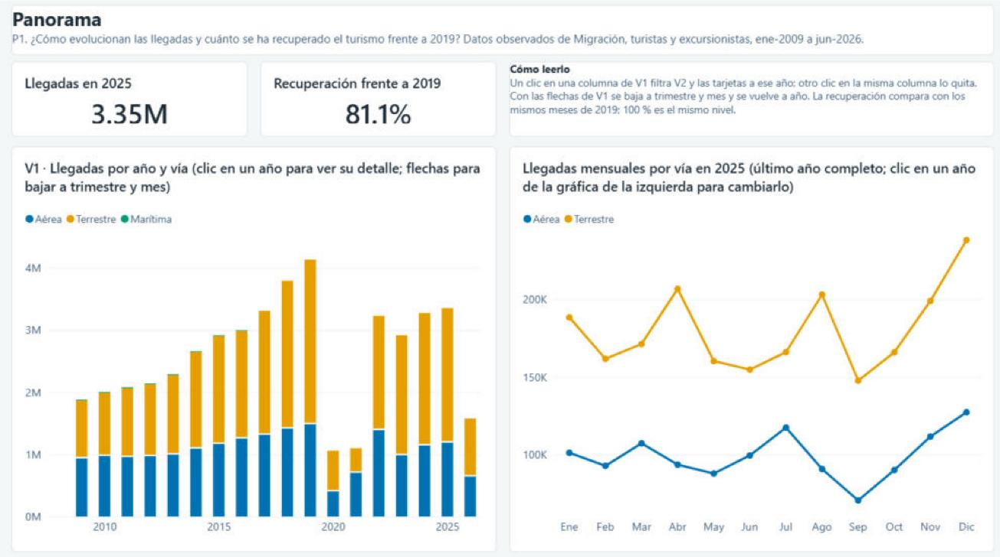
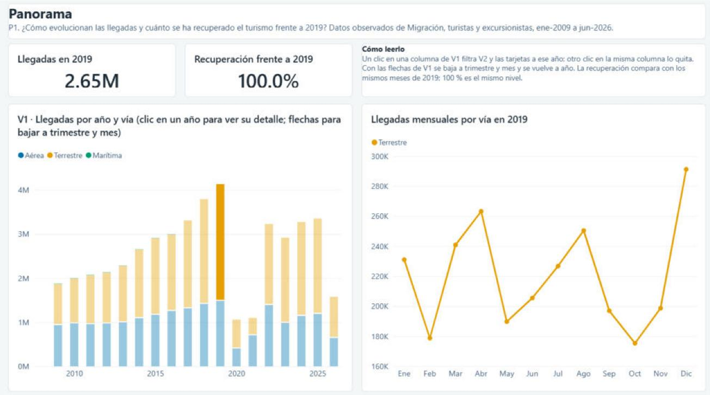
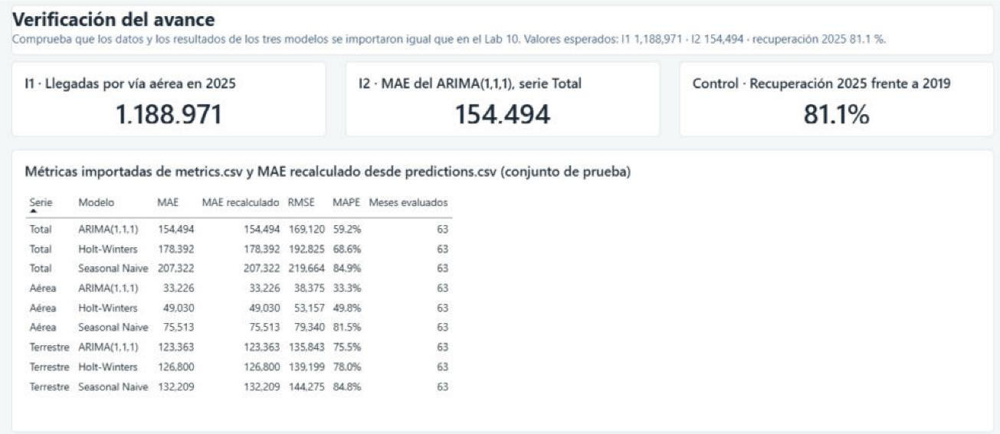

# Lab 12 — Power Query, relaciones y medidas DAX del avance

Responsable: Fernando Hernández. Archivo: `powerbi/observatorio_v1.pbix`, Power BI Desktop 2.159
(noviembre de 2026), Windows 11.

La versión 1 del informe tiene el modelo de datos completo, el tema del Laboratorio 10 y dos
visualizaciones enlazadas por filtrado cruzado en la página Panorama, V1 y V2. También importa ya las
predicciones y métricas de los tres modelos, y una página de verificación comprueba que coinciden con
el Laboratorio 10. El resto de páginas y visualizaciones las agrega Felipe Aguilar en `_v2`.

{width=100%}

## 1. Abrir el archivo y actualizar los datos

Los datos quedan guardados dentro del `.pbix`, así que para ver o editar el informe basta con abrirlo.
Solo hace falta la ruta de los CSV para actualizar, por ejemplo después de volver a correr
`scripts/export_powerbi.py`.

Todas las consultas leen la carpeta del parámetro `RutaDatos`, que hoy apunta a
`E:\UVG\Octavo\Data Science\Lab12_DS\powerbi\data\`. Power Query no acepta rutas relativas, así que
en otra computadora se cambia una sola vez en Inicio, Transformar datos, Editar parámetros, con la ruta
de `powerbi\data\` del repositorio de esa persona y terminada en `\`, y luego Actualizar.

## 2. Power Query

Hay doce consultas en cuatro grupos, el parámetro, las diez tablas y la de medidas, ordenadas en Parámetros, Dimensiones, Hechos y Medidas. Las diez tablas del
modelo estrella se importan desde `powerbi/data/` con los mismos tres pasos.

```m
let
    Origen = Csv.Document(File.Contents(RutaDatos & "fact_llegadas.csv"),
        [Delimiter = ",", Encoding = 65001, QuoteStyle = QuoteStyle.Csv]),
    Encabezados = Table.PromoteHeaders(Origen, [PromoteAllScalars = true]),
    Tipos = Table.TransformColumnTypes(Encabezados, {{"FechaId", Int64.Type},
        {"FronteraId", Int64.Type}, {"PaisId", Int64.Type}, {"MercadoId", Int64.Type},
        {"Tipo", type text}, {"Viajero", type number}}, "en-US")
in
    Tipos
```

1. Origen lee el CSV como UTF-8, código 65001. El script lo escribe con BOM, así que las tildes de Año,
   Vía, País y Región llegan bien sin configurar nada.
2. Encabezados usa la primera fila como nombres de columna.
3. Tipos fija el tipo de cada columna. Los identificadores son enteros, las cifras son números
   decimales porque los visitantes de la base traen decimales, `Fecha` es fecha y `AñoCompleto` y
   `EsExtranjero` son lógicos. La conversión se hace con la cultura `en-US`, porque los CSV usan punto
   decimal. Sin ella, una computadora con configuración regional que use coma decimal leería
   `716.000000` como 716 millones.

No hay más pasos porque la limpieza, las claves y las uniones ya las hace `scripts/export_powerbi.py`,
que tiene pruebas. Repetirlas en Power Query daría dos versiones de la misma lógica y una de ellas sin
pruebas. Power Query solo carga y tipa.

La consulta `Medidas` es una tabla vacía, `#table(type table [Columna = text], {})`, que solo sirve
para agrupar las medidas DAX en un lugar. Su columna está oculta.

También se desactivó la opción de fecha y hora automáticas del archivo. Power BI crea por defecto una
tabla de fechas oculta por cada columna de fecha, y aquí la jerarquía de fechas viene de `dim_fecha`.

## 3. Relaciones y propiedades del modelo

Son once relaciones, todas de varios a uno desde la tabla de hechos hacia la dimensión, con filtro en
una sola dirección, de la dimensión a los hechos, y activas. No hay relaciones de varios a varios, ni
bidireccionales, ni entre tablas de hechos.

| Tabla de hechos | Columna | Dimensión | Columna |
|--|--|--|--|
| `fact_llegadas` | `FechaId` | `dim_fecha` | `FechaId` |
| `fact_llegadas` | `FronteraId` | `dim_frontera` | `FronteraId` |
| `fact_llegadas` | `PaisId` | `dim_pais` | `PaisId` |
| `fact_llegadas` | `MercadoId` | `dim_mercado` | `MercadoId` |
| `fact_serie_observada` | `FechaId` | `dim_fecha` | `FechaId` |
| `fact_serie_observada` | `Serie` | `dim_serie` | `Serie` |
| `fact_predicciones` | `FechaId` | `dim_fecha` | `FechaId` |
| `fact_predicciones` | `Serie` | `dim_serie` | `Serie` |
| `fact_predicciones` | `ModeloId` | `dim_modelo` | `ModeloId` |
| `fact_metricas` | `Serie` | `dim_serie` | `Serie` |
| `fact_metricas` | `ModeloId` | `dim_modelo` | `ModeloId` |

Como se decidió en la sección 7 de `diseno.md`, `fact_metricas` no se relaciona con `dim_fecha`, porque
las métricas son del conjunto de prueba completo y no deben cambiar con un filtro de fechas, y
`dim_serie` no se relaciona con las llegadas.

Otras propiedades del modelo.

- `dim_fecha` está marcada como tabla de fechas, con `Fecha` como columna de fecha.
- Jerarquías. `Jerarquía fecha` en `dim_fecha`, Año › Trimestre › MesNombre, que usa V1 para el drill
  down. `Vía y punto` en `dim_frontera` y `Región y país` en `dim_pais`, listas para V5 y V6.
- Ordenar por columna. `MesNombre` por `Mes`, para que los meses salgan de enero a diciembre y no en
  orden alfabético. `MesAño` por `FechaId`. `Vía` por `OrdenVía`, para que Aérea, Terrestre y Marítima
  tomen siempre el primer, segundo y tercer color del tema. `Serie` por `OrdenSerie` y `Modelo` por
  `ModeloId`, en el orden del Laboratorio 10.
- Las claves, los ordenadores y las columnas numéricas de los hechos están ocultas. Así en el panel de
  datos solo aparecen las medidas y los atributos que tiene sentido arrastrar, y nadie suma
  `Viajero` o `MAE` por error en lugar de usar la medida.
- `País` tiene categoría de datos País, por si se usa en un mapa.

## 4. Medidas DAX

Están en la tabla `Medidas`, en cuatro carpetas. Cada una tiene descripción en el modelo, visible al
pasar el cursor.

### Llegadas

```dax
Llegadas = SUM ( fact_llegadas[Viajero] )

Último año completo =
CALCULATE ( MAX ( dim_fecha[Año] ), REMOVEFILTERS ( dim_fecha ), dim_fecha[AñoCompleto] = TRUE () )

Año en foco =
IF (
    ISFILTERED ( dim_fecha[Año] ),
    IF ( HASONEVALUE ( dim_fecha[Año] ), VALUES ( dim_fecha[Año] ) ),
    [Último año completo]
)

Llegadas año en foco =
VAR ultimo = [Último año completo]
RETURN
    IF (
        ISFILTERED ( dim_fecha[Año] ),
        [Llegadas],
        CALCULATE ( [Llegadas], dim_fecha[Año] = ultimo )
    )

Llegadas 2019 mismos meses =
VAR anio = [Año en foco]
VAR meses = CALCULATETABLE ( VALUES ( dim_fecha[Mes] ), dim_fecha[Año] = anio )
RETURN
    IF ( NOT ISBLANK ( anio ), CALCULATE ( [Llegadas], dim_fecha[Año] = 2019, meses ) )

Recuperación frente a 2019 =
VAR anio = [Año en foco]
VAR actual = CALCULATE ( [Llegadas], dim_fecha[Año] = anio )
RETURN
    IF ( NOT ISBLANK ( anio ), DIVIDE ( actual, [Llegadas 2019 mismos meses] ) )
```

`Llegadas` es la medida base, la suma de turistas y excursionistas con los filtros activos. Todas las
demás se construyen sobre ella.

`Llegadas año en foco` alimenta V2 y la tarjeta de llegadas. En el Laboratorio 10, V2 mostraba un solo
año. Aquí, si el usuario eligió un año, con un clic en V1 o con un filtro de año, la medida respeta esa
selección. Si no eligió ninguno, muestra el último año con los doce meses, 2025, en lugar de sumar los
diecisiete años mes por mes, que no tendría sentido. `Último año completo` se calcula con la columna
`AñoCompleto` y no está escrito a mano, así que pasará solo a 2026 cuando la base tenga diciembre de
2026.

`Recuperación frente a 2019` divide las llegadas del año en foco entre las de 2019 en los mismos meses.
Lo de los mismos meses importa para 2026, que solo tiene enero a junio. Comparar seis meses de 2026
con todo 2019 daría una caída falsa de casi la mitad. Por eso `Llegadas 2019 mismos meses` toma los
meses que tiene el año en foco dentro de los filtros activos y suma solo esos meses de 2019. Por la
misma razón, si en V1 se baja a trimestre y se elige uno, la comparación es contra el mismo trimestre
de 2019. Si hay varios años elegidos, `Año en foco` queda en blanco y la tarjeta también, en lugar de
mostrar un porcentaje sin sentido.

### Textos

```dax
Años en foco texto =
VAR anios =
    IF (
        ISFILTERED ( dim_fecha[Año] ),
        CONCATENATEX ( VALUES ( dim_fecha[Año] ), dim_fecha[Año], ", ", dim_fecha[Año], ASC ),
        FORMAT ( [Último año completo], "0" )
    )
VAR parcial =
    IF (
        ISFILTERED ( dim_fecha[Año] )
            && CALCULATE ( COUNTROWS ( dim_fecha ), dim_fecha[AñoCompleto] = FALSE () ) > 0,
        " (2026 es año parcial, ene-jun)"
    )
RETURN anios & parcial

Título V2 =
"Llegadas mensuales por vía en " & [Años en foco texto]
    & IF ( NOT ISFILTERED ( dim_fecha[Año] ),
        " (último año completo; clic en un año de la gráfica de la izquierda para cambiarlo)" )

Título tarjeta llegadas = "Llegadas en " & [Años en foco texto]
```

Los títulos de V2 y de la tarjeta se calculan con estas medidas, con formato condicional en el texto
del título. Así el usuario siempre sabe qué año está viendo, y si elige 2026 el título le avisa que es
un año parcial. Es lo mismo que hacía el Laboratorio 10 con los títulos de los callbacks.

### Modelos

```dax
Observado serie = SUM ( fact_serie_observada[Observado] )
Estimado = SUM ( fact_predicciones[Estimado] )
MAE recalculado = AVERAGE ( fact_predicciones[ErrorAbs] )
MAE = IF ( HASONEVALUE ( dim_serie[Serie] ) && HASONEVALUE ( dim_modelo[ModeloId] ),
           SUM ( fact_metricas[MAE] ) )
RMSE = IF ( HASONEVALUE ( dim_serie[Serie] ) && HASONEVALUE ( dim_modelo[ModeloId] ),
            SUM ( fact_metricas[RMSE] ) )
MAPE = IF ( HASONEVALUE ( dim_serie[Serie] ) && HASONEVALUE ( dim_modelo[ModeloId] ),
            SUM ( fact_metricas[MAPE] ) / 100 )
Meses evaluados = MAX ( fact_metricas[MesesEvaluacion] )
```

Las métricas no se recalculan en Power BI. `MAE`, `RMSE` y `MAPE` muestran el valor de `metrics.csv`
del Laboratorio 10 y solo cuando hay una serie y un modelo en el contexto, porque sumar el MAE de
varios modelos o series no significa nada. El MAPE viene en puntos porcentuales y se divide entre 100
para mostrarlo con formato de porcentaje. `MAE recalculado` es el promedio del error absoluto de
`fact_predicciones` y sirve como control. Si coincide con el reportado, las predicciones se importaron
completas y sin cambios. `Observado serie` y `Estimado` quedan listas para V4, y la columna `Error`
de `fact_predicciones` para V9.

### Verificación

```dax
I1 Llegadas aéreas 2025 =
CALCULATE ( [Llegadas], REMOVEFILTERS ( dim_fecha ), REMOVEFILTERS ( dim_frontera ),
            dim_fecha[Año] = 2025, dim_frontera[Vía] = "Aérea" )

I2 MAE ARIMA Total =
CALCULATE ( [MAE], REMOVEFILTERS ( dim_serie ), REMOVEFILTERS ( dim_modelo ),
            dim_serie[Serie] = "Total", dim_modelo[ModeloId] = 1 )

Control recuperación 2025 = CALCULATE ( [Recuperación frente a 2019], dim_fecha[Año] = 2025 )
```

Son los dos indicadores y el control de la sección 7 de `protocolo_pruebas.md`, con los filtros fijos
dentro de la medida para que den el mismo número en cualquier página.

## 5. Visualizaciones del avance

Página Panorama, P1.

- V1, gráfico de columnas apiladas. Eje con `Jerarquía fecha`, leyenda `Vía` y valor `Llegadas`. Con
  las flechas del encabezado se baja a trimestre y mes y se vuelve a año.
- V2, gráfico de líneas. Eje `MesNombre`, leyenda `Vía` y valor `Llegadas año en foco`, con el título
  dinámico `Título V2`. La interpolación es lineal. El tema base de Power BI suaviza las líneas, lo que
  dibuja curvas que pasan por encima o por debajo de los valores reales entre dos meses.
- Dos tarjetas, `Llegadas año en foco` y `Recuperación frente a 2019`, con unidades abreviadas.
- Un cuadro de texto con la pregunta de gestión y otro con cómo leer la página.

El enlace entre V1 y V2 es el filtrado cruzado nativo de Power BI. Un clic en una columna de V1 filtra
V2 y las tarjetas a ese año, y otro clic en la misma columna quita el filtro. Como V1 es apilado, el
clic se hace sobre un segmento, así que filtra el año y la vía de ese segmento. En la captura, el clic
en el segmento terrestre de 2019 deja en V2 solo la línea terrestre de 2019, y la tarjeta da 100 %
porque compara 2019 consigo mismo. Para ver todas las vías de un año se usa el segmentador de vía,
que agrega Felipe, o se elige con Ctrl y clic cada segmento de ese año.

{width=100%}

Los colores de las vías están fijados en cada gráfico, Aérea `#0072B2`, Terrestre `#E69F00` y
Marítima `#009E73`, además del orden por `OrdenVía`, para que no cambien si un filtro deja fuera
alguna vía. El tema `powerbi/tema_observatorio.json` está aplicado al informe.

## 6. Verificación de los datos y de los resultados de los modelos

La página Verificación del avance muestra los indicadores del protocolo y la tabla de métricas de los
nueve pares serie y modelo.

{width=100%}

| Indicador | Lab 10 | Power BI v1 | ¿Coincide? |
|--|--|--|--|
| I1. Llegadas por vía aérea en 2025 | 1,188,971 | 1,188,971 | Sí |
| I2. MAE del ARIMA(1,1,1), serie Total | 154,494 | 154,494 | Sí |
| Control. Recuperación 2025 frente a 2019 | 81.1 % | 81.1 % | Sí |
| Llegadas totales 2025 | 3,352,289 | 3.35 M | Sí |

En la tabla, el MAE recalculado desde las predicciones es igual al MAE de `metrics.csv` en las nueve
filas, y los 63 meses de evaluación coinciden con el conjunto de prueba de abril de 2021 a junio de
2026. Con eso, los datos y los resultados de los tres modelos entraron completos al modelo.

## 7. Notas para la versión 2

- `Año en foco` detecta la selección con `ISFILTERED ( dim_fecha[Año] )`. Un segmentador de año debe
  usar la columna `Año` de `dim_fecha`. Un segmentador de rango sobre `Fecha` no lo activa, y V2
  seguiría mostrando 2025.
- La página Verificación del avance se puede ocultar en la entrega final o reutilizar para la prueba de
  indicadores de Nicolás.
- Las tarjetas de I1 e I2 muestran la cifra completa con el separador de miles de la configuración
  regional de Windows, que en este equipo es el punto, 1.188.971. El resto del informe usa el formato
  de la medida, con coma.
- Para que V3 a V9 tomen los colores correctos, las vías se fijan como en V1 y V2 y los modelos con el
  color de `dim_modelo`, morado, rosa y gris.
